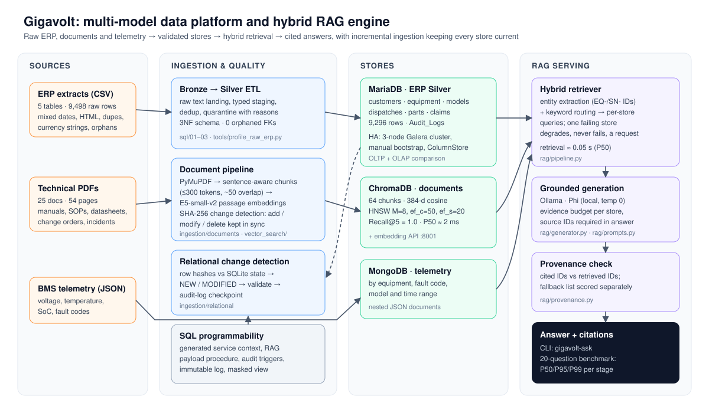

# Gigavolt: Multi-Model Data Platform & Hybrid RAG Engine

A data platform and retrieval-augmented generation (RAG) system for an industrial battery manufacturer's field-service team. It takes messy ERP extracts, technical PDFs and battery telemetry and lands them in the store that fits each data type: **MariaDB** for relational ERP data, **ChromaDB** for semantic document search and **MongoDB** for telemetry. It keeps all three current with incremental ingestion, and answers natural-language questions with a local LLM that is checked against the evidence it was given.

> *"Show the service history for EQ-5508 and what the manual says about over-temperature alarms."*
> → equipment, dispatch and warranty records from MariaDB + recent readings and fault events from MongoDB + the relevant manual passages from ChromaDB → answer with source IDs → citation check.



## Highlights

| Area | What was built | Result |
|---|---|---|
| **Data quality** | Bronze → staging → quarantine → Silver pipeline in SQL with unit-tested cleansing functions; a profiler measures every raw-data defect | 9,498 raw rows → 9,296 clean rows; **0 orphaned foreign keys**; rebuild matches production on **99.993%** of 83,834 cells and fixed 4 production defects |
| **SQL engineering** | 3NF schema, generated RAG-context column, payload procedure, audit triggers, immutable audit log, PII-masked view | **46 / 46** automated checks (integrity, programmability, cleansing-function unit tests) |
| **High availability** | 3-node MariaDB Galera cluster on EC2 + EBS, manual `grastate.dat` bootstrap protocol, ColumnStore on node 3 | Writes continued through a single-node failure; failed node rejoined and resynced |
| **Vector search** | Sentence-aware token chunking, E5 embeddings, HNSW grid search (9 configs) | Recall@5 = **1.0** vs exact search at **~2 ms** median; source Hit@5 = **1.00**, MRR = **0.893** |
| **Hybrid RAG** | Entity- and keyword-routed retrieval across 3 stores, fault-tolerant per route, Ollama/Phi generation | 20/20 benchmark questions answered; retrieval **≈ 0.05 s**, generation 99.5% of latency |
| **Incremental ingestion** | SHA-256 change detection for rows and PDFs, SQLite checkpoints, audit-log cursor | 1 changed row out of 9,296 detected; PDF add/delete moved the index 64 → 66 → 64 |
| **Provenance** | Citation validator + offline re-audit of saved answers | Found and fixed metric inflation: fallback source lists were being scored as model citations ([details](docs/hybrid-rag.md#provenance-and-the-citation-audit)) |

## Tech stack

**Python** (PyMySQL, PyMongo, ChromaDB, Sentence-Transformers, PyMuPDF) · **MariaDB** (Galera, ColumnStore, triggers, generated columns, stored procedures, MariaDB Vector) · **MongoDB** · **ChromaDB / HNSW** · **Ollama (Phi)** · **AWS EC2 + EBS** · **systemd** · pytest · ruff · GitHub Actions

## Repository layout

```
src/gigavolt/
├── config.py                 # all endpoints, credentials and paths from the environment
├── retrieval/                # MariaDB, MongoDB and ChromaDB clients with retry + reconnect
├── rag/                      # hybrid pipeline, generator, prompts, citation validation
├── ingestion/relational/     # row-hash change detection, validation, audit checkpoint
├── ingestion/documents/      # shared chunker + incremental ChromaDB sync
├── services/                 # embedding API and document-ingestion HTTP trigger
└── cli.py                    # gigavolt-ask
sql/                          # schema, Bronze load, cleansing, programmability, validation, deploy.sh
sql/legacy_v1/                # first version of the ingestion/cleansing pipeline
vector_search/                # corpus build, HNSW tuning, latency/recall benchmarks, notebook
benchmarks/                   # RAG benchmark, citation re-audit, saved results
tools/                        # raw-data quality profiler, Silver reconciliation
tests/                        # 52 offline unit tests + MariaDB integration tests
deploy/systemd/               # service units for the vector/document server
docs/                         # design notes per subsystem
```

## Quick start

The unit tests need no databases, model servers or network access:

```bash
pip install -e ".[dev]"
ruff check .
pytest -q
```

Build the database from the raw ERP CSVs and validate it (MariaDB 10.11+):

```bash
sql/deploy.sh --raw-dir data/raw/erp --validate
GIGAVOLT_TEST_MARIADB=1 pytest -q tests/test_integration_mariadb.py
```

Run the system against configured stores (see [deployment](docs/deployment.md)):

```bash
cp .env.example .env
gigavolt-ingest-relational              # incremental relational sync
gigavolt-ingest-documents --apply       # incremental document sync (vector server)
gigavolt-ask "Which lithium cell components are below their reorder level?"
python benchmarks/rag_benchmark.py
```

## Design decisions

* **One engine per data shape.** ERP entities need foreign keys and joins (MariaDB). Telemetry is nested, schema-flexible JSON queried by unit and time (MongoDB). Manuals need semantic similarity (ChromaDB). The RAG layer composes them; no store has to imitate another.
* **Lakehouse layers as SQL schemas.** The ERP data is small and transactional, so Bronze, staging, quarantine and Silver live in one engine, linked by `bronze_row_id`. Bad rows go to quarantine with a reason instead of disappearing.
* **Prove the rebuild.** The cleansing pipeline was reconciled cell by cell against the production load. Every remaining difference is explained, either as a documented defect fix or as a duplicate-resolution choice.
* **Degrade, don't fail.** Each retrieval route catches its own errors and reports them with the answer, and every client retries transient errors with reconnect. A dead store reduces evidence; it does not take the assistant down.
* **Commit state last.** Both ingestion pipelines persist their checkpoint only after the downstream write succeeds, so interrupted runs are retried, never lost. Documents are replaced upsert-first, delete-obsolete-second.
* **One chunker.** Batch corpus builds and incremental updates share the same chunking code, so chunk IDs are deterministic and identical across both paths.
* **Measure the right thing.** Vector latency excludes query embedding, RAG latency is split into retrieval and generation, and citations are scored at claim level separately from the fallback list.

## Results and documentation

| Topic | Doc | Evidence |
|---|---|---|
| Lakehouse, cleansing, reconciliation, schema, SQL objects | [data-platform.md](docs/data-platform.md) | [raw profile](benchmarks/results/raw_erp_profile.json), [`sql/90–92`](sql/), [`compare_silver.py`](tools/compare_silver.py) |
| Galera cluster, bootstrap, failover, ColumnStore | [high-availability.md](docs/high-availability.md) | |
| Chunking, embeddings, HNSW tuning | [vector-search.md](docs/vector-search.md) | [vector results](benchmarks/results/vector/), [notebook](vector_search/notebooks/vector_search_benchmark.ipynb) |
| Retrieval routing, generation, provenance | [hybrid-rag.md](docs/hybrid-rag.md) | [citation audit](benchmarks/results/rag/citation_audit_20261115_075228.json) |
| Incremental ingestion, recovery, benchmark | [operations.md](docs/operations.md) | [RAG runs](benchmarks/results/rag/), [pipeline logs](docs/evidence/) |
| Two-server deployment | [deployment.md](docs/deployment.md) | [systemd units](deploy/systemd/) |

## Limitations and next steps

* **Latency:** median end-to-end time is about 14 s against a 5 s goal. Retrieval is 0.05 s; the rest is CPU inference of a local model. Next: GPU or hosted inference, plus streaming.
* **Citations:** the small model rarely writes well-formed inline citations (3 of 20 answers were fully clean). Next: structured JSON output with per-claim source IDs, and rejection or retry of answers that fail validation.
* **Orchestration:** the ingestion jobs are independent, idempotent CLIs, not yet a single scheduled DAG.
* **Scale:** the corpus is 64 chunks and 200 telemetry documents. The tuning and benchmark scripts are built to re-run as it grows.

## Background

Built over a semester as a six-phase data-engineering project on AWS. The phases were: ingestion and cleansing → SQL programmability → high availability and analytics → vector search → multi-model RAG → automation and evaluation. Source datasets were supplied with the course and are not redistributed here (see [deployment.md](docs/deployment.md#data)).
