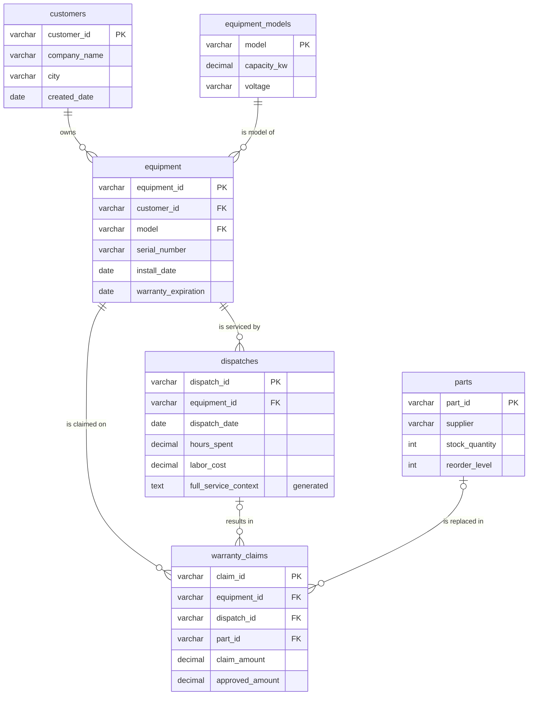

# Data platform: lakehouse layers, data quality and SQL programmability

## Lakehouse layers

The relational lakehouse is implemented as SQL schemas inside MariaDB rather than as Parquet files. The ERP data is small, highly relational and is queried transactionally by the RAG layer, so keeping all layers in one engine gives foreign-key enforcement, triggers and point lookups without a separate query engine. Lineage between layers is kept with a `bronze_row_id` column.

| Layer | Tables | Purpose |
|---|---|---|
| **Bronze** | `bronze_customers`, `bronze_equipment`, `bronze_dispatches`, `bronze_parts`, `bronze_warranty_claims` | The CSV extracts loaded exactly as received. Every column is `VARCHAR`/`TEXT`, so nothing is lost or coerced on ingest. |
| **Staging** | `silver_*_staging`, `silver_equipment_before_dedup` | Typed, cleansed rows that still carry `bronze_row_id`. The pre-dedup snapshot is kept for audit. |
| **Quarantine** | `dispatches_quarantine`, `warranty_claims_quarantine` | Rows that break referential integrity, each stored with a `quarantine_reason` instead of being silently dropped. |
| **Silver** | `customers`, `equipment`, `equipment_models`, `dispatches`, `parts`, `warranty_claims` | A normalized 3NF model with primary and foreign keys enforced. |

DDL for each layer is in [`sql/01_bronze_schema.sql`](../sql/01_bronze_schema.sql), [`sql/02_silver_schema.sql`](../sql/02_silver_schema.sql) and [`sql/03_staging_and_quarantine.sql`](../sql/03_staging_and_quarantine.sql).

## Data-quality profile of the raw extracts

[`tools/profile_raw_erp.py`](../tools/profile_raw_erp.py) measures every issue the cleansing step has to resolve. The figures below are its output for the five source CSVs. The full report is in [`benchmarks/results/raw_erp_profile.json`](../benchmarks/results/raw_erp_profile.json).

| Issue | Evidence in the raw data |
|---|---|
| Mixed date formats | Five formats in every date column: `MM/DD/YYYY`, `MM-DD-YYYY`, `YYYY/MM/DD`, `YYYY-MM-DD` and ISO-8601 timestamps (`2022-02-06T00:00:00Z`). |
| HTML in text fields | 1,148 cells, e.g. `<b>Volt Corporation</b>` and `<html><body>Replaced burnt fuse block…</body></html>`. |
| Padded whitespace | 1,223 cells, e.g. `"   Mike Johnson"`. |
| Duplicate primary keys | 148 rows: 25 customers, 75 equipment, 48 warranty claims. |
| Currency strings in numeric columns | 256 `labor_cost` values such as `$1,005.00`. |
| `NULL` written as text | 491 `approved_amount` values. |
| Inconsistent casing | Status values such as `IN SERVICE`, `In Service` and `in service`. |
| Orphaned foreign keys | 59 dispatches pointing to equipment that does not exist, 7 claims → dispatches, 13 claims → parts. |

## Bronze-to-Silver reconciliation

| Table | Raw rows | Silver rows | Difference explained by |
|---|---:|---:|---|
| customers | 525 | 500 | 25 duplicate IDs |
| equipment | 2,575 | 2,500 | 75 duplicate IDs |
| dispatches | 5,000 | 4,941 | 59 orphaned `equipment_id` (quarantined) |
| parts | 150 | 150 | none |
| warranty_claims | 1,248 | 1,200 | 48 duplicate IDs |
| **Total** | **9,498** | **9,291 + 5 models** | **207 rows resolved** |

The 5 rows in `equipment_models` were derived during normalization, which gives 9,296 Silver rows in total. Warranty claims with dangling optional references (dispatch or part) keep the claim and null out the bad reference, so no claim is lost for a non-key field.

## Entity-relationship model

`capacity_kw` and `voltage` depend on the model, not on the individual unit. Moving them into `equipment_models` removes the transitive dependency `equipment_id → model → capacity_kw`.

## SQL programmability

| Object | File | What it does |
|---|---|---|
| `dispatches.full_service_context` | [`10_generated_columns.sql`](../sql/10_generated_columns.sql) | A `VIRTUAL` generated column that renders each dispatch as a labelled text block for RAG. It is computed at read time, so it never drifts from the row and costs no storage. |
| `Audit_Logs` | [`11_audit_log.sql`](../sql/11_audit_log.sql) | An append-only change history. `BEFORE UPDATE` and `BEFORE DELETE` triggers raise `SQLSTATE 45000`, so audit rows cannot be altered or removed. |
| `trg_Dispatches_After_Insert`, `trg_Dispatches_Before_Update` | [`12_audit_triggers.sql`](../sql/12_audit_triggers.sql) | Capture the new row, and the before and after values, for every insert and update on `dispatches`. |
| `sp_Prepare_RAG_Payloads()` | [`13_rag_payload_procedure.sql`](../sql/13_rag_payload_procedure.sql) | Joins dispatches with equipment and returns one labelled service-history payload per dispatch. |
| `vw_Customer_Safe` | [`14_security_views.sql`](../sql/14_security_views.sql) | Column-level masking: exposes customer attributes without phone, email or street address. Applications are granted the view, not the base table. |

## Validation

[`sql/deploy.sh`](../sql/deploy.sh) applies the scripts in dependency order. It loads an optional data-only seed before the change-capture triggers, so the bulk load is not audited. With `--validate` it then runs two check suites:

* [`90_validate_integrity.sql`](../sql/90_validate_integrity.sql) covers 18 checks: row counts, zero orphans across all six foreign-key relationships, and domain rules (warranty after install, non-negative amounts, approved ≤ claimed, no leftover HTML or padding).
* [`91_validate_programmability.sql`](../sql/91_validate_programmability.sql) covers 11 checks. It confirms the objects exist and the view hides PII. It also inserts and updates a dispatch inside a transaction to prove both triggers fire, and attempts an `UPDATE` and a `DELETE` on `Audit_Logs` to prove both are rejected. The transaction is then rolled back and a check confirms no test data remains.

Against the full Silver dataset, all **29 of 29 checks pass**, and re-running the deployment is idempotent. As an independent cross-check, every one of the 9,296 rows in the rebuilt database produces a SHA-256 row hash identical to the hashes recorded by the production ingestion state on EC2.
