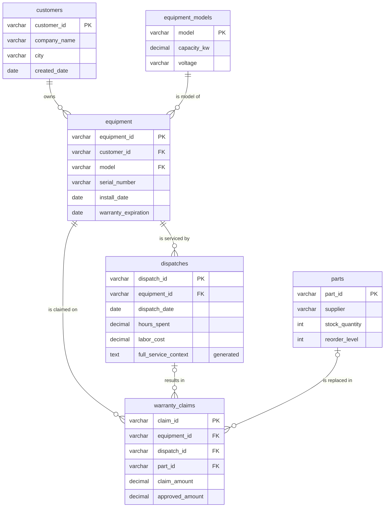

# Milestone 1 · Data Ingestion, Cleansing & Lakehouse Foundation

Raw ERP extracts (customers, equipment, service dispatches, parts, warranty claims) land in a **Bronze** layer exactly as received. They are cleansed into typed staging tables, deduplicated, quarantined where they break referential integrity, and loaded into a normalized **3NF Silver** model in MariaDB.

| | |
|---|---|
| **Input** | 5 CSV extracts · 9,498 raw rows · 5 date formats, HTML, duplicates, currency strings, orphans |
| **Output** | 6 Silver tables · 9,296 rows · **0 orphaned foreign keys** |
| **Validation** | 20 integrity checks + 15 cleansing-function unit tests, all passing |
| **Reconciliation** | Rebuild matches the production load on **99.993%** of 83,834 cells; 4 production defects found and fixed |

## What's here

| Path | Contents |
|---|---|
| [`sql/00_create_database.sql`](sql/00_create_database.sql) | Database bootstrap |
| [`sql/01_bronze_schema.sql`](sql/01_bronze_schema.sql) | Bronze landing tables (all text, `bronze_row_id` lineage key) |
| [`sql/02_silver_schema.sql`](sql/02_silver_schema.sql) | 3NF Silver tables with primary and foreign keys |
| [`sql/03_staging_and_quarantine.sql`](sql/03_staging_and_quarantine.sql) | Typed staging, pre-dedup snapshot, quarantine tables |
| [`sql/04_cleansing_functions.sql`](sql/04_cleansing_functions.sql) | `clean_text()`, `clean_date()`, `clean_money()` |
| [`sql/05_load_bronze.sql`](sql/05_load_bronze.sql) | CRLF-aware `LOAD DATA` of the five CSVs |
| [`sql/06_cleanse_to_silver.sql`](sql/06_cleanse_to_silver.sql) | Staging → dedup → quarantine → Silver, with a reconciliation summary |
| [`validation/`](validation/) | Integrity checks and cleansing-function unit tests |
| [`tools/profile_raw_erp.py`](tools/profile_raw_erp.py) | Measures every data-quality defect in the raw CSVs |
| [`tools/compare_silver.py`](tools/compare_silver.py) | Cell-by-cell reconciliation of two Silver databases |
| [`results/raw_erp_profile.json`](results/raw_erp_profile.json) | Profiler output for the raw extracts |
| [`legacy_v1/`](legacy_v1/) | First version of this pipeline, kept for reference |

## Run it

```bash
# From the repo root: schema + Bronze load + cleansing + M2 objects, then every check
scripts/deploy_database.sh --raw-dir data/raw/erp --validate

# Data-quality profile of the raw extracts
python m1-erp-pipeline/tools/profile_raw_erp.py data/raw/erp
```

## Lakehouse layers

The relational lakehouse is implemented as SQL schemas inside MariaDB rather than as Parquet files. The ERP data is small, highly relational and is queried transactionally by the RAG layer, so keeping all layers in one engine gives foreign-key enforcement, triggers and point lookups without a separate query engine. Lineage between layers is kept with a `bronze_row_id` column.

| Layer | Tables | Purpose |
|---|---|---|
| **Bronze** | `bronze_customers`, `bronze_equipment`, `bronze_dispatches`, `bronze_parts`, `bronze_warranty_claims` | The CSV extracts loaded exactly as received. Every column is `VARCHAR`/`TEXT`, so nothing is lost or coerced on ingest. |
| **Staging** | `silver_*_staging`, `silver_equipment_before_dedup` | Typed, cleansed rows that still carry `bronze_row_id`. The pre-dedup snapshot is kept for audit. |
| **Quarantine** | `dispatches_quarantine`, `warranty_claims_quarantine` | Rows that break referential integrity, each stored with a `quarantine_reason` instead of being silently dropped. |
| **Silver** | `customers`, `equipment`, `equipment_models`, `dispatches`, `parts`, `warranty_claims` | A normalized 3NF model with primary and foreign keys enforced. |

DDL for each layer is in [`sql/01_bronze_schema.sql`](sql/01_bronze_schema.sql), [`sql/02_silver_schema.sql`](sql/02_silver_schema.sql) and [`sql/03_staging_and_quarantine.sql`](sql/03_staging_and_quarantine.sql). The data moves through the layers with [`sql/05_load_bronze.sql`](sql/05_load_bronze.sql) and [`sql/06_cleanse_to_silver.sql`](sql/06_cleanse_to_silver.sql), which `scripts/deploy_database.sh --raw-dir <csv-folder>` runs end to end.

## Data-quality profile of the raw extracts

[`tools/profile_raw_erp.py`](tools/profile_raw_erp.py) measures every issue the cleansing step has to resolve. The figures below are its output for the five source CSVs. The full report is in [`results/raw_erp_profile.json`](results/raw_erp_profile.json).

| Issue | Evidence in the raw data |
|---|---|
| Mixed date formats | Five formats in every date column: `MM/DD/YYYY`, `MM-DD-YYYY`, `YYYY/MM/DD`, `YYYY-MM-DD` and ISO-8601 timestamps (`2022-02-06T00:00:00Z`). |
| HTML in text fields | 1,148 cells, e.g. `<b>Volt Corporation</b>` and `<html><body>Replaced burnt fuse block…</body></html>`. |
| Padded whitespace | 1,223 cells, e.g. `"   Mike Johnson"`. |
| Duplicate primary keys | 148 rows: 25 customers, 75 equipment, 48 warranty claims. |
| Currency strings in numeric columns | 256 `labor_cost` values such as `$1,005.00`. |
| `NULL` written as text | 491 `approved_amount` values. |
| Inconsistent casing | Status values such as `IN SERVICE`, `In Service` and `in service`. |
| Orphaned foreign keys | 59 dispatches point to equipment that does not exist (`EQ-99xxx`). Warranty-claim references that look orphaned are the literal string `NULL`, now counted as missing (246 blank dispatch references, 361 blank part references). |

## Cleansing pipeline

`sql/05_load_bronze.sql` loads the five CSVs with `LINES TERMINATED BY '\r\n'`, because the extracts are CRLF files. `sql/06_cleanse_to_silver.sql` then:

1. writes typed **staging** rows using three deterministic functions from [`sql/04_cleansing_functions.sql`](sql/04_cleansing_functions.sql), unit-tested in [`validation/validate_cleansing_functions.sql`](validation/validate_cleansing_functions.sql);
2. **deduplicates** on each business key, keeping the most recent row (highest `bronze_row_id`), and keeps a pre-dedup equipment snapshot;
3. **quarantines** dispatches whose equipment does not exist, then loads Silver. A warranty claim that points to a quarantined dispatch keeps its row; the dangling reference is nulled and logged in `warranty_claims_quarantine`.

| Rule | Implementation |
|---|---|
| HTML, carriage returns, repeated spaces | `clean_text()` strips tags and `\r`, collapses spaces and trims |
| Null tokens | `''`, `NULL` and `N/A` become SQL `NULL` *after* tags are stripped, so `<p>N/A</p>` is caught too |
| Five date formats | `clean_date()` turns `MM/DD/YYYY`, `MM-DD-YYYY`, `YYYY/MM/DD`, `YYYY-MM-DD` and ISO timestamps into `DATE` |
| Currency | `clean_money()` turns `$1,005.00` into `1005.00` |
| Phone | digits only; an 11-digit `+1` number loses the country code |
| Zip | zero-padded to 5 digits (`2113` → `02113`) |
| Country | `US` / `USA` / `United States` → `United States`; blank → `NULL` |
| Status and model codes | upper-cased (`in service`, `In Service` → `IN SERVICE`) |
| Email | lower-cased |

The first version of this pipeline (separate `gigavolt_erp` schema, `cx()`/`nd()` helpers, first-row-wins dedup) is kept in [`legacy_v1/`](legacy_v1/). The current rules evolved from it.

## Bronze-to-Silver reconciliation

| Table | Raw rows | Silver rows | Difference explained by |
|---|---:|---:|---|
| customers | 525 | 500 | 25 duplicate IDs |
| equipment | 2,575 | 2,500 | 75 duplicate IDs |
| dispatches | 5,000 | 4,941 | 59 orphaned `equipment_id` (quarantined) |
| parts | 150 | 150 | none |
| warranty_claims | 1,248 | 1,200 | 48 duplicate IDs |
| **Total** | **9,498** | **9,291 + 5 models** | **207 rows resolved** |

The 5 rows in `equipment_models` were derived during normalization, which gives 9,296 Silver rows in total. 13 surviving claims referenced a quarantined dispatch: they keep the claim, null the reference, and are logged in `warranty_claims_quarantine`, so no claim is lost for a non-key field.

## Reconciliation against the production load

The Silver layer the RAG system ran on in production was loaded on EC2. To prove the pipeline in this repository reproduces it, the Silver layer was rebuilt from the raw CSVs and compared with a restored copy of production, cell by cell, using [`tools/compare_silver.py`](tools/compare_silver.py).

| | Cells (of 83,834) |
|---|---:|
| Identical without any adjustment | 80,751 (96.3%) |
| Identical after applying four documented production fixes | **83,828 (99.993%)** |
| Remaining: 4 duplicate groups where production kept a different copy | 6 |

The comparison surfaced four **defects in the original production load**. The rebuilt pipeline fixes all four, and [`validation/validate_integrity.sql`](validation/validate_integrity.sql) now checks for them:

| Defect | Cells | Cause |
|---|---:|---|
| Trailing `\r` on `customers.status` (`'INACTIVE\r'`) | 500 | CRLF files loaded with a `\n` line terminator; the last column kept the carriage return, so `WHERE status = 'INACTIVE'` matched nothing |
| `equipment.location_notes` uncleaned (`\r`, `'NULL'` text, repeated spaces) | 2,500 | the column was never cleansed, and it was also the last column of a CRLF file |
| Zip codes missing leading zeros (`2113` for Boston) | 13 | leading zeros lost in the source export, never restored |
| `denial_reason = 'N/A'` surviving as text | 64 | the null-token check ran before tag stripping, so `<p>N/A</p>` became `'N/A'` |

The 6 remaining cells belong to 3 customers and 1 piece of equipment whose duplicates production resolved differently from the "latest row wins" rule (22 of 25 duplicate customers, and every duplicate equipment and claim group, follow it). With the production seed loaded, the validation suite reports exactly two failing checks (carriage returns and 5-digit zips); with the rebuilt Silver, every check passes.

## Entity-relationship model



`capacity_kw` and `voltage` depend on the model, not on the individual unit. Moving them into `equipment_models` removes the transitive dependency `equipment_id → model → capacity_kw`.

## Validation

[`scripts/deploy_database.sh`](../scripts/deploy_database.sh) applies every script in dependency order. Data comes either from the raw CSVs (`--raw-dir`) or from a data-only seed (`--seed`). Both are loaded before the change-capture triggers exist, so the bulk load is not audited. With `--validate` it runs:

* [`validation/validate_integrity.sql`](validation/validate_integrity.sql): 20 checks covering row counts, zero orphans across all six foreign-key relationships, and domain rules (warranty after install, non-negative amounts, approved ≤ claimed, no leftover HTML, padding or carriage returns, 5-digit zips).
* [`validation/validate_cleansing_functions.sql`](validation/validate_cleansing_functions.sql): 15 unit tests of the cleansing functions, built from real raw-data defects. They need no data, so CI runs them on every push.
* The [Milestone 2](../m2-database-logic/) programmability suite (11 checks).

Built from the raw CSVs, **all 46 checks pass** and re-running is idempotent. Loading the production seed instead reproduces production exactly: all 9,296 rows hash identically to the hashes recorded by the production ingestion state on EC2. In that mode the two defect checks fail by design.
